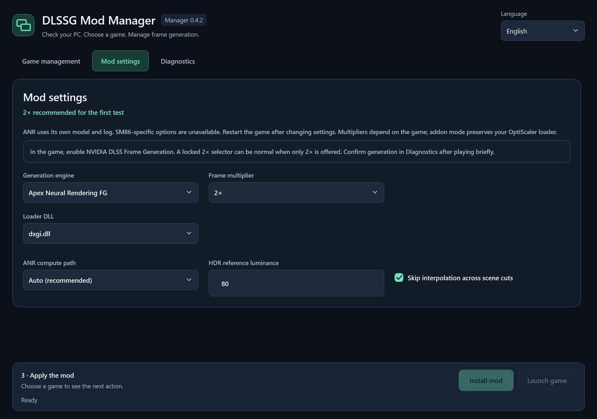

# DLSSG Mod Manager

**Read in:** **English** · [Italiano](docs/i18n/README.it.md) · [简体中文](docs/i18n/README.zh-Hans.md) · [हिन्दी](docs/i18n/README.hi.md) · [Español](docs/i18n/README.es.md) · [Français](docs/i18n/README.fr.md) · [العربية](docs/i18n/README.ar.md) · [বাংলা](docs/i18n/README.bn.md) · [Português](docs/i18n/README.pt.md) · [Русский](docs/i18n/README.ru.md) · [اردو](docs/i18n/README.ur.md)

A Windows desktop companion for [DLSSG for SM86](https://github.com/sdli1995/dlssg_for_sm86) and [Apex Neural Rendering](https://github.com/apex-compute/ANR): check a PC and game, install a verified mod package, and keep a recoverable history of changes.

## Credits

- **Original mod:** [DLSSG for SM86](https://github.com/sdli1995/dlssg_for_sm86), by [sdli1995](https://github.com/sdli1995) and the project's contributors.
- **RTX 20 / SM75 adaptation:** [Coldwood1026](https://github.com/Coldwood1026), credited in the [upstream notices](https://github.com/sdli1995/dlssg_for_sm86/blob/main/THIRD_PARTY_NOTICES.txt).
- **This manager:** an independent installation and diagnostics interface. Credit for the original mod remains with its authors; the manager does not claim their work or official endorsement.

## ANR integration — stable manager 0.4.2

[Download stable v0.4.2](https://github.com/VenomDrake/DLSSG-MANAGER-RTX-3000-SERIES/releases/tag/v0.4.2): [portable ZIP](https://github.com/VenomDrake/DLSSG-MANAGER-RTX-3000-SERIES/releases/download/v0.4.2/DLSSGModManager-Portable-win-x64.zip) · [Windows installer](https://github.com/VenomDrake/DLSSG-MANAGER-RTX-3000-SERIES/releases/download/v0.4.2/DLSSGModManager-Setup.msi). The manager is a stable release. **ANR itself remains upstream beta FG-V.B15**; its Beta label refers to the provider, not to this manager release.

- Choose **Frame generation technology**: the original SM86 path (NVIDIA DLSS-G / XeSS-FG), or **Apex Neural Rendering · Beta**. The manager supports ANR on **NVIDIA GTX 16 / RTX 20–50** and **AMD Radeon RX 5000/6000/7000/9000**; **GTX 10 / Pascal is unsupported**. The game must provide native DLSS Frame Generation through **Direct3D 12 or Vulkan**.
- This manager supports ANR on **Windows 10/11 x64** only; **Linux, Steam Deck and Intel Arc are outside this release’s supported scope**. AMD coverage was checked with automated tests, not an in-game test on AMD hardware. Confirm actual generation in the game log.
- The manager selects **Full** for a game without OptiScaler or **Addon** for a compatible existing OptiScaler installation. Packages are downloaded directly from the official upstream release and checked using SHA-256; ANR and OptiScaler binaries/models are **not bundled with the manager**. The reviewed ANR recipe is **FG-V.B15**; a future unknown recipe stays blocked. The manager checks the official ANR repository at startup when ANR is selected and whenever you select ANR. It downloads a new release automatically, or reports that the cached release is already the latest. Each game is updated only when you click the update action, after the checks and backup.
- Close the game before installing or switching. The manager verifies conflicts, records owned files and creates recoverable backups before changes. Provider switching, disabling and restoring use the same journal and history; unknown or externally modified files are protected. Addon mode preserves the existing OptiScaler loader. Use **Restore previous state** to undo a provider switch.
- Begin offline at **2×**. ANR has its own compute-path, HDR luminance and scene-cut settings and its own log; SM86-only settings do not apply. Multipliers depend on the game. Log confirmation is a smoke test, not a long gameplay stability guarantee. Do not use either provider in anti-cheat-protected online games.

In the game, enable **NVIDIA DLSS Frame Generation**. A grey or locked **2×** selector can be normal when that is the only multiplier offered; it does not prove that frame generation is active. Play briefly, then read the log in **Diagnostics**. For ANR, check successful generated evaluations and generation errors, not just “ANR loaded”. A partial or oversized log cannot confirm a complete session. If it stays pending, close the game and read the log again.

**ANR credits:** [Apex Compute / Apex Neural Rendering](https://github.com/apex-compute/ANR); [OptiScaler](https://github.com/optiscaler/OptiScaler) and its contributors. OptiScaler is GPL-3.0; ANR code, binaries and model terms remain those of their authors. The manager does not relicense upstream material. See the [upstream licence question](https://github.com/apex-compute/ANR/issues/9).




## What it does

- Organizes game management, mod settings and diagnostics into three clear pages, keeping the original navy background and mint accents.
- Checks the latest official **complete release asset** on startup, before hardware and game analysis. It downloads a new package automatically and reports when the verified cache is already current.
- Compares release ID, asset ID and SHA-256, including replacement assets with the same version number. Offline status is distinct from “latest version.”
- Checks Windows x64 and GPU architecture and drivers according to the selected provider: NVIDIA-only for SM86, supported NVIDIA or AMD GPUs for ANR. SM86 requires hardware-accelerated GPU scheduling (HAGS); active scheduling is confirmed only by the game’s runtime log. ANR has no upstream-specified HAGS requirement.
- Accepts a game folder or rendering EXE and discovers installed games across Steam libraries. It finds Unreal rendering executables and lets you resolve ambiguous choices.
- Examines x64 architecture, native DLSS-G runtime generation, DirectX 12 / Vulkan evidence, known anti-cheat indicators, existing loaders, game processes and space. Static file evidence does not certify that a game will work.
- **SM86:** Shows engine, multiplier, optimization, preset, SR override, XeSS flow/HUD settings, loader and logging options. **DLSS, 2×, exact-output optimization and SR override Off are recommended defaults.**
- Installs or updates only after review and confirmation. It stages verified files, backs up the previous state, deactivates old loaders before changing runtime files, and activates the new loader last.
- Offers disable and restore, protects files modified outside the manager, and records a recovery journal for interrupted changes. Backups are retained, including displaced extra files.
- **SM86:** Reads the latest recorded game session. It requires successful creation of NGX feature 11 and its first evaluation to report actual frame generation.
- ANR diagnostics distinguish loading from actual frame generation and show generated-evaluation and generation-error counts for a complete recorded session.
- Exports a local diagnostic report with user/game paths redacted. There are no accounts or telemetry.

## Find your way around

- **Game management:** choose a game, read the compatibility result and use the main install/update action at the bottom.
- **Mod settings:** view every available option in one place, with recommended defaults preselected.
- **Diagnostics:** inspect all checks and the recorded game log, export a report, disable the mod or restore the previous state.

## Download and use

[Download stable v0.4.2](https://github.com/VenomDrake/DLSSG-MANAGER-RTX-3000-SERIES/releases/tag/v0.4.2): [portable ZIP](https://github.com/VenomDrake/DLSSG-MANAGER-RTX-3000-SERIES/releases/download/v0.4.2/DLSSGModManager-Portable-win-x64.zip) · [Windows installer](https://github.com/VenomDrake/DLSSG-MANAGER-RTX-3000-SERIES/releases/download/v0.4.2/DLSSGModManager-Setup.msi).

Use `DLSSGModManager.exe` from the portable package, or run the per-user `DLSSGModManager-Setup.msi`. No separate .NET, Python or CUDA Toolkit installation is needed for the published binaries.

> **Online games: risk of a ban**
>
> Using this mod changes game files. We strongly recommend using it only in offline single-player games. Anti-cheat systems or game rules may treat it as an unauthorized modification and issue a ban. No bypass or protection against bans is provided.

1. Open the manager and let it check/download the official mod package.
2. In **Game management**, choose a Steam game, a game folder, or its rendering EXE.
3. Read the main result panel; open **Diagnostics** for all checks. A detected anti-cheat, unsupported runtime, unknown conflicting loader or running game prevents installation.
4. Review all options in **Mod settings**; start at **2×**. Choose **Install mod** or **Update mod** in the bottom action bar and confirm the target.
5. Launch the game and enable **DLSS Frame Generation** in its graphics settings. Some games require a restart.
6. In **Diagnostics**, choose **Read game log** to see whether the mod loaded, the feature was created and generation actually began.

The manager does not change HAGS or drivers automatically. It opens Windows graphics settings and the appropriate NVIDIA or AMD driver page. For SM86, enable HAGS and restart Windows, then confirm it in the game log. ANR’s upstream project does not specify a HAGS requirement.

## Updating the manager

The manager quietly checks its own GitHub releases in the background. A small notice appears only when a newer stable manager version is available; draft releases and prereleases are ignored.

Both stable **0.3.1 / 0.4.1** and **0.4.0 beta** installations can update to stable **0.4.2** through **Update and restart**. The stable updater offers this release; no beta opt-in is required.

Choose **Update and restart** when convenient, after the current operation finishes. The manager automatically selects the portable ZIP or MSI for the current installation, downloads it, verifies its SHA-256 against the official GitHub release asset digest, closes, installs the update and reopens. Games, settings and backups are preserved. Future updates do not require visiting GitHub or replacing files manually.

**Moving from 0.1.0 to 0.2.0 requires one manual update**, because 0.1.0 does not contain the updater. Close 0.1.0, then run the new MSI or extract the complete new portable package into your portable application folder, using the same package type as before. Starting with 0.2.0, subsequent manager updates can be installed in the app.

**One-time fix for MSI installations of 0.2.0/0.2.1:** their in-app MSI updater may fail with Windows Installer error **1639** or show its help window. Close the manager, download and run the **latest MSI (0.2.2 or later) once** from the release linked above, keeping the same installation folder. Installing the 0.2.1 MSI does not fix this defect. After 0.2.2 is installed, future in-app updates use the corrected updater. Portable installations are not affected by this MSI issue.

Manager updates and mod updates are separate. Updating the manager does not change any game installation. The reviewed provider recipes are **SM86 0.4.1** and **ANR FG-V.B15**.

## Supported scope and limitations

The manager runs on **Windows 10/11 x64**. **SM86** targets supported **RTX 20/30** GPUs; its reviewed recipe is upstream **0.4.1**, with driver **R580 or newer** and runtime **310.9.16**. **ANR** supports **NVIDIA GTX 16 / RTX 20–50** and **AMD Radeon RX 5000/6000/7000/9000**, requires native DLSS Frame Generation through **Direct3D 12 or Vulkan**, and uses the reviewed **FG-V.B15** recipe. **GTX 10 / Pascal is unsupported.** Downloading a newer upstream release does not approve its requirements: unknown recipes stay blocked until the manager is updated.

**SM86:** The game must supply native DLSS Frame Generation and run with DirectX 12. Runtime 310.x is supported by the current upstream recipe; old runtime generations are refused. A higher multiplier depends on the game's integration. XeSS is capped at 4×; DLSS 6× requires a game integration that supports it.

Known anti-cheat indicators block installation. Their absence does not prove that a game has no anti-cheat. Do not use injected mods in anti-cheat-protected online games.

**SM86:** Existing manual installations matching the current verified release can be adopted after their DLL hashes are checked. An older or unknown manual mod without a manager record is treated as a conflict instead of being overwritten. Installs subsequently made by the manager can be updated and restored using their inventory and backups. **ANR:** An unmanaged manual ANR installation is treated as a conflict.

The first verification in a log is a smoke test, not a guarantee of long gameplay stability or doubled rendered FPS. Displayed generated frames and input latency are different measurements.

The manager and MSI are unsigned in this build. No signing certificate is imported. Upstream's 0.4.1 package has a self-signed test certificate whose name differs from its README; package provenance is verified against the GitHub asset digest, not against Windows publisher trust.

## Languages

English is the source language, with Italian, Simplified Chinese, Hindi, Spanish, French, Arabic, Bengali, Portuguese, Russian and Urdu. The app follows a supported Windows UI language and lets you change it. Arabic and Urdu use right-to-left layout. All 11 resource files have the same keys; community review of translations is welcome. Advanced configuration tokens and diagnostic exception details may retain their original technical names.

## Local data and recovery

- Verified package cache and language preference: `%LOCALAPPDATA%\DLSSGModManager`.
- Game inventory: `.dlssg-manager.json` beside the rendering EXE.
- Backups: `.dlssg-manager-backups` beside that EXE. Keep this directory to preserve restoration history.
- A `.dlssg-manager.transaction.json` file marks an interrupted operation; the next install/restore/disable recovers it before proceeding and requires the game to be closed.

Use **Restore previous state** repeatedly to step back through managed updates. Restoring the first managed install returns the original state, including an adopted manual installation. Disabling simply moves the owned loader out of its active DLL name. The manager does not remove unknown user files or silently undo externally edited managed files.

Uninstalling the manager through Windows removes the manager application, not mods installed in games. Restore the affected games before uninstalling if you also want those mods removed. Game backups and the downloaded cache are retained.

## Build and test

Install the .NET 10 SDK on Windows x64, then run:

```powershell
.\scripts\test.ps1
.\scripts\build.ps1
```

The build script publishes a self-contained single-file app, a portable ZIP, an MSI and SHA-256 checksums in `artifacts`. WiX 4.0.6 is installed as a build tool under `tools` if needed. No downloaded mod DLLs are included in the output.

Tests use synthetic packages and an innocuous versioned x64 fixture DLL. They do not require a game, NVIDIA or AMD hardware or a network connection. An optional live release test is available with `dotnet run --project tests/ReleaseTests -- --live`.

For a read-only UI preview against a local game:

```powershell
dotnet run --project src/DlssgManager.Desktop -- --read-only --game 'D:\Games\Example'
```

`--data-dir <path>` isolates the manager's cache and preferences for testing. `--read-only` disables game file changes.

## Publish your fork

Create a public GitHub repository and push this source tree. The included Windows workflow builds and tests pull requests and main-branch pushes. A tag such as `v0.4.2` also publishes the binaries as a GitHub release using that repository's Actions token. No token is stored in source or required by end users.

See [CONTRIBUTING.md](CONTRIBUTING.md), [SECURITY.md](SECURITY.md), and [THIRD_PARTY_NOTICES.md](THIRD_PARTY_NOTICES.md). This independent manager is MIT-licensed; upstream mod material has its own terms.
