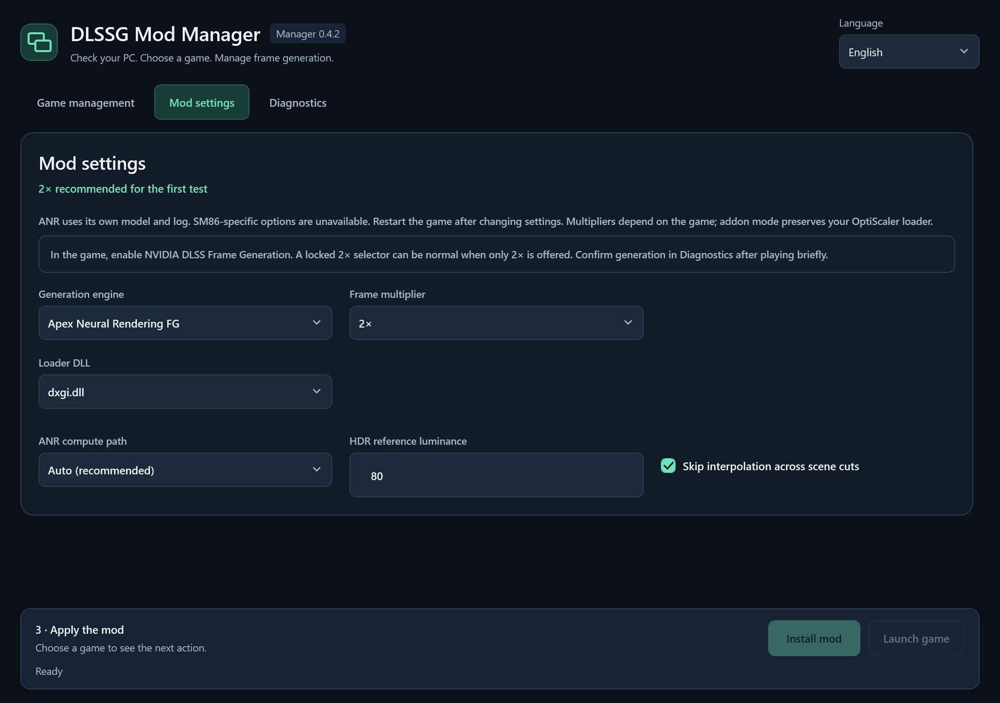

# DLSSG Mod Manager

**Leer en:** [English](../../README.md) · [Italiano](README.it.md) · [简体中文](README.zh-Hans.md) · [हिन्दी](README.hi.md) · **Español** · [Français](README.fr.md) · [العربية](README.ar.md) · [বাংলা](README.bn.md) · [Português](README.pt.md) · [Русский](README.ru.md) · [اردو](README.ur.md)

Una aplicación de escritorio para Windows que complementa [DLSSG for SM86](https://github.com/sdli1995/dlssg_for_sm86) y [Apex Neural Rendering](https://github.com/apex-compute/ANR): comprueba el PC y el juego, instala un paquete verificado del mod y conserva un historial de cambios que permite recuperar el estado anterior.

## Créditos

- **Mod original:** [DLSSG for SM86](https://github.com/sdli1995/dlssg_for_sm86), de [sdli1995](https://github.com/sdli1995) y los colaboradores del proyecto.
- **Adaptación para RTX 20 / SM75:** [Coldwood1026](https://github.com/Coldwood1026), reconocido en los [avisos del proyecto original](https://github.com/sdli1995/dlssg_for_sm86/blob/main/THIRD_PARTY_NOTICES.txt).
- **Este gestor:** una interfaz independiente de instalación y diagnóstico. El mérito del mod original corresponde a sus autores; el gestor no se atribuye su trabajo ni afirma tener su aprobación oficial.

## Integración ANR — gestor estable 0.4.2

[Descarga la versión estable v0.4.2](https://github.com/VenomDrake/DLSSG-MANAGER-RTX-3000-SERIES/releases/tag/v0.4.2): [ZIP portátil](https://github.com/VenomDrake/DLSSG-MANAGER-RTX-3000-SERIES/releases/download/v0.4.2/DLSSGModManager-Portable-win-x64.zip) · [instalador de Windows](https://github.com/VenomDrake/DLSSG-MANAGER-RTX-3000-SERIES/releases/download/v0.4.2/DLSSGModManager-Setup.msi). El gestor es una versión estable. **ANR sigue siendo la beta FG-V.B15 del proyecto original**; la etiqueta Beta se refiere a esa tecnología, no a esta versión del gestor.

- Elige **Tecnología de generación de fotogramas**: SM86 original (NVIDIA DLSS-G / XeSS-FG) o **Apex Neural Rendering · Beta**. El gestor admite ANR en **NVIDIA GTX 16 / RTX 20–50** y **AMD Radeon RX 5000/6000/7000/9000**; **GTX 10 / Pascal no es compatible**. El juego debe ofrecer DLSS Frame Generation nativo mediante **Direct3D 12 o Vulkan**.
- Este gestor admite ANR solo en **Windows 10/11 x64**; **Linux, Steam Deck e Intel Arc quedan fuera del alcance compatible de esta versión**. La compatibilidad con AMD se comprobó mediante pruebas automáticas, sin una prueba en el juego con hardware AMD. Confirma la generación real en el registro del juego.
- El gestor elige **Full** si el juego no tiene OptiScaler o **Addon** para una instalación OptiScaler compatible. Descarga los paquetes directamente de la versión oficial y verifica SHA-256; los binarios y modelos ANR y OptiScaler **no se incluyen con el gestor**. La receta ANR revisada es **FG-V.B15**; las futuras recetas desconocidas quedan bloqueadas. El gestor comprueba el repositorio oficial de ANR al iniciar si ANR está seleccionado y cada vez que eliges ANR. Descarga automáticamente una versión nueva o indica que la versión en caché ya es la última. Cada juego se actualiza solo al pulsar la acción de actualización, tras las comprobaciones y la copia de seguridad.
- Cierra el juego antes de instalar o cambiar. El gestor verifica conflictos, registra los archivos gestionados y crea copias recuperables antes de modificar. El cambio de proveedor, la desactivación y la restauración comparten diario e historial; los archivos desconocidos o modificados externamente están protegidos. Addon conserva el cargador OptiScaler existente. Usa **Restaurar estado anterior** para deshacer el cambio.
- Empieza sin conexión a **2×**. ANR tiene ajustes propios de ruta de cálculo, luminancia HDR y cambios de escena, y su propio registro; las opciones exclusivas de SM86 no se aplican. Los multiplicadores dependen del juego. La confirmación del registro es una prueba inicial, no garantiza estabilidad prolongada. No uses ningún proveedor en juegos online protegidos por anti-cheat.

Activa **NVIDIA DLSS Frame Generation** en el juego. El selector **2×** gris o bloqueado puede ser normal si es el único multiplicador disponible; no demuestra que la generación esté activa. Juega brevemente y lee el registro en **Diagnóstico**. Para ANR, comprueba las evaluaciones de generación correctas y los errores, no solo “ANR cargado”. Un registro parcial o demasiado grande no permite confirmar toda la sesión. Si sigue pendiente, cierra el juego y vuelve a leer el registro.

**Créditos ANR:** [Apex Compute / Apex Neural Rendering](https://github.com/apex-compute/ANR); [OptiScaler](https://github.com/optiscaler/OptiScaler) y sus colaboradores. OptiScaler usa GPL-3.0; código, binarios y modelos ANR siguen sujetos a los términos de sus autores. El gestor no cambia sus licencias. Consulta la [pregunta sobre la licencia](https://github.com/apex-compute/ANR/issues/9).




## Funciones

- Organiza la gestión de juegos, los ajustes del mod y el diagnóstico en tres páginas claras, conservando el fondo azul oscuro y los detalles originales en verde menta.
- Al iniciarse, comprueba el **paquete completo de la última versión oficial**, antes de analizar el hardware y el juego. Descarga automáticamente un paquete nuevo e indica cuándo la caché verificada ya está actualizada.
- Compara el ID de la versión, el ID del archivo y SHA-256, detectando también archivos reemplazados sin cambiar el número de versión. El estado sin conexión se distingue de “última versión”.
- Comprueba Windows x64, la arquitectura GPU y los controladores según la tecnología elegida: solo NVIDIA para SM86, GPU NVIDIA o AMD compatibles para ANR. SM86 requiere programación de GPU acelerada por hardware (HAGS); solo se confirma su activación mediante el registro del runtime del juego. El proyecto ANR no especifica un requisito de HAGS.
- Acepta una carpeta de juego o su EXE de renderizado y descubre los juegos instalados en las bibliotecas de Steam. Encuentra los ejecutables de renderizado de Unreal y permite resolver selecciones ambiguas.
- Examina la arquitectura x64, la generación del runtime DLSS-G nativo, indicios de DirectX 12 / Vulkan, indicadores conocidos de anti-cheat, cargadores existentes, procesos del juego y espacio disponible. La presencia de archivos no certifica que un juego vaya a funcionar.
- **SM86:** Muestra el motor, multiplicador, optimización, preajuste, sustitución de SR, ajustes de flujo/HUD de XeSS, cargador y opciones de registro. **Los valores recomendados son DLSS, 2×, optimización con salida exacta y sustitución de SR desactivada (Off).**
- Solo instala o actualiza después de revisar y confirmar. Prepara los archivos verificados, guarda una copia del estado anterior, desactiva los cargadores antiguos antes de modificar los archivos del runtime y activa el nuevo cargador al final.
- Permite desactivar y restaurar, protege los archivos modificados fuera del gestor y registra un diario de recuperación para cambios interrumpidos. Conserva las copias de seguridad, incluidos los archivos adicionales desplazados.
- **SM86:** Lee la última sesión de juego registrada. Para confirmar la generación real de fotogramas exige la creación correcta de la función NGX 11 y su primera evaluación.
- El diagnóstico de ANR distingue la carga de la generación real y muestra los recuentos de evaluaciones y errores de generación de una sesión registrada completa.
- Exporta un informe de diagnóstico local con las rutas del usuario y del juego ocultas. No requiere cuentas ni recopila telemetría.

## Cómo orientarse

- **Gestión de juegos:** elige un juego, consulta el resultado de compatibilidad y usa la acción principal de instalación o actualización de la parte inferior.
- **Ajustes del mod:** consulta todas las opciones disponibles, con los valores recomendados ya seleccionados.
- **Diagnóstico:** revisa todas las comprobaciones y el registro del juego, exporta un informe, desactiva el mod o restaura el estado anterior.

## Descarga y uso

[Descarga la versión estable v0.4.2](https://github.com/VenomDrake/DLSSG-MANAGER-RTX-3000-SERIES/releases/tag/v0.4.2): [ZIP portátil](https://github.com/VenomDrake/DLSSG-MANAGER-RTX-3000-SERIES/releases/download/v0.4.2/DLSSGModManager-Portable-win-x64.zip) · [instalador de Windows](https://github.com/VenomDrake/DLSSG-MANAGER-RTX-3000-SERIES/releases/download/v0.4.2/DLSSGModManager-Setup.msi).

Utiliza `DLSSGModManager.exe` del paquete portátil o ejecuta `DLSSGModManager-Setup.msi`, que instala el programa para el usuario actual. Los binarios publicados no requieren instalar por separado .NET, Python ni CUDA Toolkit.

> **Juegos en línea: riesgo de expulsión**
>
> Usar este mod modifica los archivos del juego. Recomendamos encarecidamente usarlo solo en juegos sin conexión para un jugador. Los sistemas antitrampas o las reglas del juego pueden considerarlo una modificación no autorizada y sancionarte con una expulsión. No se proporciona ningún método de evasión ni protección contra expulsiones.

1. Abre el gestor y deja que compruebe o descargue el paquete oficial del mod.
2. En **Gestión de juegos**, elige un juego de Steam, una carpeta de juego o su EXE de renderizado.
3. Lee el panel de resultados y abre **Diagnóstico** para ver todas las comprobaciones. Un anti-cheat detectado, un runtime no compatible, un cargador desconocido en conflicto o el juego en ejecución impiden la instalación.
4. Revisa todas las opciones en **Ajustes del mod** y empieza con **2×**. Elige **Instalar mod** o **Actualizar mod** en la barra de acciones inferior y confirma el destino.
5. Inicia el juego y activa **DLSS Frame Generation** en sus ajustes gráficos. Algunos juegos requieren reiniciarse.
6. En **Diagnóstico**, elige **Leer registro del juego** para comprobar si el mod se cargó, si se creó la función y si la generación comenzó realmente.

El gestor no modifica HAGS ni los controladores automáticamente. Abre los ajustes gráficos de Windows y la página adecuada de controladores NVIDIA o AMD. Para SM86, activa HAGS y reinicia Windows; después confirma su activación en el registro del juego. El proyecto ANR no especifica un requisito de HAGS.

## Actualizar el gestor

El gestor comprueba silenciosamente sus propias versiones de GitHub en segundo plano. Solo aparece un pequeño aviso cuando hay una versión estable más reciente del gestor; se omiten los borradores y las versiones preliminares.

Tanto la versión estable **0.3.1 / 0.4.1** como **0.4.0 beta** pueden actualizarse a la estable **0.4.2** mediante **Actualizar y reiniciar**. Se ofrece en el canal estable; no hace falta activar las betas.

Elige **Actualizar y reiniciar** cuando te convenga, tras finalizar la operación actual. El gestor selecciona automáticamente el ZIP portable o el MSI adecuado para la instalación actual, lo descarga, verifica su SHA-256 con el resumen del archivo de la versión oficial de GitHub, se cierra, instala la actualización y vuelve a abrirse. Se conservan los juegos, los ajustes y las copias de seguridad. Las próximas actualizaciones no requieren visitar GitHub ni sustituir archivos manualmente.

**El paso de 0.1.0 a 0.2.0 requiere una única actualización manual**, porque 0.1.0 no incluye el actualizador. Cierra 0.1.0 y ejecuta el nuevo MSI o extrae el nuevo paquete portable completo en la carpeta de tu aplicación portable, usando el mismo tipo de paquete que antes. A partir de 0.2.0, las siguientes actualizaciones del gestor se pueden instalar desde la aplicación.

**Corrección única para las instalaciones MSI 0.2.0/0.2.1:** su actualización MSI desde la aplicación puede fallar con el error **1639** de Windows Installer o mostrar su ventana de ayuda. Cierra el gestor, descarga y ejecuta **una vez el MSI más reciente (0.2.2 o posterior)** de la versión indicada arriba y conserva la misma carpeta de instalación. Instalar el MSI 0.2.1 no corrige este fallo. Tras instalar 0.2.2, las siguientes actualizaciones desde la aplicación utilizan el actualizador corregido. Las instalaciones portátiles no se ven afectadas por este problema de MSI.

Las actualizaciones del gestor y de los mods son independientes. Actualizar el gestor no cambia ninguna instalación en los juegos. Los procedimientos revisados son **SM86 0.4.1** y **ANR FG-V.B15**.

## Compatibilidad y limitaciones

El gestor funciona en **Windows 10/11 x64**. **SM86** está destinado a las GPU **RTX 20/30** compatibles; el procedimiento revisado corresponde al mod **0.4.1**, con controlador **R580 o posterior** y runtime **310.9.16**. **ANR** admite **NVIDIA GTX 16 / RTX 20–50** y **AMD Radeon RX 5000/6000/7000/9000**, requiere DLSS Frame Generation nativo mediante **Direct3D 12 o Vulkan** y usa el procedimiento revisado **FG-V.B15**. **GTX 10 / Pascal no es compatible.** Descargar una versión nueva del proyecto original no aprueba sus requisitos: los procedimientos desconocidos siguen bloqueados hasta que se actualice el gestor.

**SM86:** El juego debe incluir DLSS Frame Generation nativo y ejecutarse con DirectX 12. El procedimiento actual admite runtimes 310.x; las generaciones antiguas se rechazan. Un multiplicador más alto depende de la integración del juego. XeSS está limitado a 4×; DLSS 6× requiere una integración que lo admita.

Los indicadores conocidos de anti-cheat bloquean la instalación. Su ausencia no demuestra que un juego carezca de anti-cheat. No utilices mods inyectados en juegos en línea protegidos por anti-cheat.

**SM86:** Las instalaciones manuales existentes que coincidan con la versión verificada actual pueden incorporarse a la gestión tras comprobar los hashes de sus DLL. Un mod manual antiguo o desconocido sin un registro del gestor se trata como un conflicto en lugar de sobrescribirse. Las instalaciones realizadas posteriormente por el gestor pueden actualizarse y restaurarse mediante su inventario y sus copias de seguridad. **ANR:** Una instalación manual de ANR no gestionada se trata como un conflicto.

La primera verificación en un registro es una prueba inicial, no una garantía de estabilidad en sesiones largas ni de duplicar los FPS renderizados. Los fotogramas generados que se muestran y la latencia de entrada son medidas diferentes.

El gestor y el MSI no están firmados en esta compilación. No se importa ningún certificado de firma. El paquete original 0.4.1 utiliza un certificado de prueba autofirmado cuyo nombre difiere del indicado en su README; la procedencia del paquete se verifica mediante el resumen criptográfico del archivo de GitHub, no mediante la confianza de Windows en el editor.

## Idiomas

El inglés es el idioma de origen; también están disponibles italiano, chino simplificado, hindi, español, francés, árabe, bengalí, portugués, ruso y urdu. La aplicación sigue un idioma de interfaz de Windows compatible y permite cambiarlo. El árabe y el urdu usan una disposición de derecha a izquierda. Los 11 archivos de recursos tienen las mismas claves; se agradece la revisión comunitaria de las traducciones. Los valores de configuración avanzados y los detalles de las excepciones de diagnóstico pueden conservar sus nombres técnicos originales.

## Datos locales y recuperación

- Caché verificada de paquetes y preferencia de idioma: `%LOCALAPPDATA%\DLSSGModManager`.
- Inventario del juego: `.dlssg-manager.json` junto al EXE de renderizado.
- Copias de seguridad: `.dlssg-manager-backups` junto a ese EXE. Conserva esta carpeta para mantener el historial de restauración.
- El archivo `.dlssg-manager.transaction.json` señala una operación interrumpida; la siguiente instalación, restauración o desactivación la recupera antes de continuar y requiere que el juego esté cerrado.

Utiliza **Restaurar estado anterior** repetidamente para retroceder por las actualizaciones gestionadas. Restaurar la primera instalación gestionada devuelve el estado original, incluida una instalación manual incorporada al gestor. Desactivar solo mueve el cargador gestionado fuera de su nombre de DLL activo. El gestor no elimina archivos desconocidos del usuario ni revierte silenciosamente las modificaciones externas de archivos gestionados.

Desinstalar el gestor desde Windows elimina la aplicación, no los mods instalados en los juegos. Restaura los juegos afectados antes de desinstalarlo si también quieres quitar esos mods. Las copias de seguridad de los juegos y la caché descargada se conservan.

## Compilación y pruebas

Instala el SDK de .NET 10 en Windows x64 y ejecuta:

```powershell
.\scripts\test.ps1
.\scripts\build.ps1
```

El script de compilación publica una aplicación autónoma de un solo archivo, un ZIP portátil, un MSI y sumas de comprobación SHA-256 en `artifacts`. Si es necesario, WiX 4.0.6 se instala como herramienta de compilación en `tools`. La salida no incluye DLL descargadas del mod.

Las pruebas utilizan paquetes sintéticos y una DLL de prueba x64 inocua con metadatos de versión. No requieren juegos, hardware NVIDIA o AMD ni conexión de red. Hay una prueba opcional de la versión en línea con `dotnet run --project tests/ReleaseTests -- --live`.

Para abrir una vista previa de la interfaz en modo de solo lectura sobre un juego local:

```powershell
dotnet run --project src/DlssgManager.Desktop -- --read-only --game 'D:\Games\Example'
```

`--data-dir <path>` aísla la caché y las preferencias del gestor para las pruebas. `--read-only` desactiva los cambios en los archivos del juego.

## Publicar tu fork

Crea un repositorio público de GitHub y sube este árbol de código fuente. El flujo de trabajo de Windows incluido compila y prueba las pull requests y los envíos a la rama principal. Una etiqueta como `v0.4.2` también publica los binarios como una versión de GitHub mediante el token de Actions del repositorio. No se guarda ningún token en el código fuente ni se exige a los usuarios finales.

Consulta [CONTRIBUTING.md](../../CONTRIBUTING.md), [SECURITY.md](../../SECURITY.md) y [THIRD_PARTY_NOTICES.md](../../THIRD_PARTY_NOTICES.md). Este gestor independiente tiene licencia MIT; el material del mod original mantiene sus propias condiciones.
