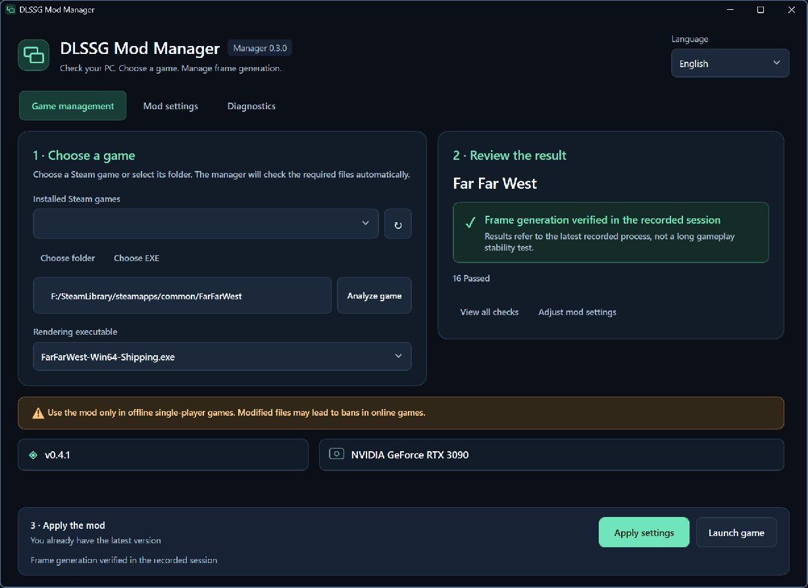

# DLSSG Mod Manager

**阅读语言:** [English](../../README.md) · [Italiano](README.it.md) · **简体中文** · [हिन्दी](README.hi.md) · [Español](README.es.md) · [Français](README.fr.md) · [العربية](README.ar.md) · [বাংলা](README.bn.md) · [Português](README.pt.md) · [Русский](README.ru.md) · [اردو](README.ur.md)

[DLSSG for SM86](https://github.com/sdli1995/dlssg_for_sm86) 的 Windows 桌面管理工具：检查电脑与游戏、安装经过验证的模组包，并保留可恢复的更改历史。

## 致谢

- **原始模组：** [DLSSG for SM86](https://github.com/sdli1995/dlssg_for_sm86)，由 [sdli1995](https://github.com/sdli1995) 及该项目的贡献者开发。
- **RTX 20 / SM75 适配：** [Coldwood1026](https://github.com/Coldwood1026)，其贡献列于[原项目声明](https://github.com/sdli1995/dlssg_for_sm86/blob/main/THIRD_PARTY_NOTICES.txt)。
- **本管理器：** 独立的安装和诊断界面。原始模组的功劳归其作者所有；本管理器不将其成果归为己有，也不声称获得官方认可。



## 功能

- 将界面分为三个清晰的页面：**游戏管理**、**模组设置**和**诊断**，保留原有的深蓝色背景和薄荷绿点缀。
- 启动时先检查最新官方**完整发布包**，再分析硬件和游戏。自动下载新包，并在已验证的缓存为最新版本时明确提示。
- 比较发布 ID、附件 ID 和 SHA-256，包括版本号相同但附件已被替换的情况。离线状态与“最新版本”明确区分。
- 检查 NVIDIA 架构与驱动、Windows x64 和 GPU 调度配置。只有游戏运行时日志报告 GPU 调度已启用时，才确认其处于生效状态。
- 支持选择游戏文件夹或渲染 EXE，并发现各个 Steam 库中的已安装游戏。识别 Unreal 渲染程序；存在多个候选项时可由用户选择。
- 检查 x64 架构、游戏原生 DLSS-G 运行库代际、DirectX 12 相关证据、已知反作弊特征、现有加载器、游戏进程和磁盘空间。静态文件检查不能保证游戏实际可用。
- 显示生成引擎、倍率、优化级别、预设、超分辨率覆盖、XeSS 光流/HUD 设置、加载器和日志选项。**建议默认使用 DLSS、2×、精确输出优化，并关闭超分辨率覆盖。**
- 仅在用户审阅并确认后安装或更新。先暂存已验证的文件并备份原状态；替换运行库前停用旧加载器，最后才启用新加载器。
- 提供停用和恢复功能，保护在管理器外修改的文件，并记录恢复日志以处理意外中断。保留备份，包括操作中移出的额外文件。
- 读取最新记录的游戏会话。只有 NGX 功能 11 创建成功并完成首次评估后，才报告帧生成确实开始运行。
- 导出保存在本地的诊断报告，隐去用户和游戏路径。无需账户，也不收集遥测数据。

## 下载与使用

下载 [v0.3.0 公开预览版](https://github.com/VenomDrake/DLSSG-MANAGER-RTX-3000-SERIES/releases/tag/v0.3.0)：[便携 ZIP](https://github.com/VenomDrake/DLSSG-MANAGER-RTX-3000-SERIES/releases/download/v0.3.0/DLSSGModManager-Portable-win-x64.zip) · [Windows 安装程序](https://github.com/VenomDrake/DLSSG-MANAGER-RTX-3000-SERIES/releases/download/v0.3.0/DLSSGModManager-Setup.msi)。后续版本请查看[所有发布版本](https://github.com/VenomDrake/DLSSG-MANAGER-RTX-3000-SERIES/releases)。

运行便携包中的 `DLSSGModManager.exe`，或使用仅为当前用户安装的 `DLSSGModManager-Setup.msi`。发布的二进制程序无需单独安装 .NET、Python 或 CUDA Toolkit。

> **在线游戏：存在封禁风险**
>
> 使用此模组会修改游戏文件。我们强烈建议仅在离线单人游戏中使用。反作弊系统或游戏规则可能将其视为未经授权的修改，并导致封禁。我们不提供任何绕过措施或防封禁保护。

### 页面导航

- **游戏管理：**选择游戏，查看兼容性结果和下一步操作，然后安装或更新模组。
- **模组设置：**所有模组选项都在这里；首次测试建议使用 **2×**。
- **诊断：**查看完整检查列表、游戏日志，以及停用模组和恢复先前状态的工具。

1. 打开管理器，等待它检查并下载官方模组包。
2. 在**游戏管理**中选择 Steam 游戏、游戏文件夹或其渲染 EXE。
3. 在主页面查看结果，打开**诊断**查看完整检查列表。检测到反作弊、不受支持的运行库、未知的加载器冲突或游戏正在运行时，将阻止安装。
4. 打开**模组设置**并检查选项，首次从 **2×** 开始。选择**安装模组（Install mod）**或**更新模组（Update mod）**，并确认目标位置。
5. 启动游戏，在图形设置中启用 **DLSS Frame Generation**。某些游戏需要重新启动。
6. 在**诊断**中选择**读取游戏日志（Read game log）**，检查模组是否加载、功能是否创建，以及帧生成是否真正开始。

管理器不会自动更改 HAGS 或驱动。它会打开 Windows 图形设置或 NVIDIA 驱动页面，并提供操作说明。启用 HAGS 后请重启 Windows。

## 更新管理器

管理器会在后台静默检查自身的 GitHub 发布版本。只有发现更新的稳定版管理器时，才会显示一条小提示；草稿和预发布版本会被忽略。

请在当前操作结束后，选择合适的时间点击 **更新并重启**。管理器会自动选择适合当前安装方式的便携 ZIP 或 MSI，下载软件包，将其 SHA-256 与 GitHub 官方发布文件的摘要进行核对，然后关闭、安装更新并重新打开。游戏、设置和备份都会保留。以后的更新无需访问 GitHub 或手动替换文件。

**从 0.1.0 升级到 0.2.0 需要手动更新一次**，因为 0.1.0 尚未包含更新功能。关闭 0.1.0，然后运行新的 MSI，或将完整的新便携软件包解压到便携应用文件夹，保持与之前相同的软件包类型。从 0.2.0 起，后续管理器更新可在应用内安装。

**MSI 安装版 0.2.0/0.2.1 的一次性修复：** 这些版本的应用内 MSI 更新可能出现 Windows Installer 错误 **1639**，或弹出其帮助窗口。请关闭管理器，从上方链接的发布页下载并**运行一次最新版 MSI 安装程序（0.2.2 或更高版本）**，保留原安装目录。安装 0.2.1 MSI 无法修复此缺陷。安装 0.2.2 后，后续应用内更新将使用已修复的更新程序。便携版安装不受此 MSI 问题影响。

管理器更新与模组更新相互独立。更新管理器不会为任何游戏安装新模组；已审查的原项目安装规则仍对应 **0.4.1**。

## 支持范围与限制

管理器面向 Windows 10/11 x64，以及原项目支持的 RTX 20/30 显卡。目前已审查的安装规则对应原项目 **0.4.1**，要求 R580 或更新的驱动，并使用 310.9.16 运行库。管理器仍会下载未来的官方版本，但对于未知安装规则，会在管理器的检查逻辑更新前标记为不受支持；新的版本号不代表要求一定兼容。

游戏本身必须提供原生 DLSS Frame Generation，并以 DirectX 12 运行。当前原项目安装规则支持 310.x 运行库；更旧的运行库代际会被拒绝。更高倍率取决于游戏的集成方式。XeSS 最高为 4×；DLSS 6× 需要游戏集成本身支持。

检测到已知反作弊特征时会阻止安装。未检测到这些特征并不能证明游戏没有反作弊。请勿在受反作弊保护的联网游戏中使用注入式模组。

对于与当前已验证发布包一致的手动安装，可以在检查 DLL 哈希后接管管理。缺少管理器记录的旧版或未知手动模组将被视为冲突，不会直接覆盖。之后通过管理器完成的安装，可使用其文件清单与备份进行更新和恢复。

日志中的首次验证只是基本运行测试，并不保证长时间游戏稳定，也不保证实际渲染 FPS 翻倍。显示出的生成帧与输入延迟是不同的衡量指标。

此构建的管理器和 MSI 尚未进行代码签名。不会导入任何签名证书。原项目 0.4.1 发布包使用自签名测试证书，其名称与 README 中的说明不同；发布包来源通过 GitHub 附件摘要验证，而非通过 Windows 发布者信任验证。

## 语言

源语言为英语，另提供意大利语、简体中文、印地语、西班牙语、法语、阿拉伯语、孟加拉语、葡萄牙语、俄语和乌尔都语。应用会采用受支持的 Windows 界面语言，也允许手动更改。阿拉伯语和乌尔都语使用从右向左布局。全部 11 个资源文件使用相同的键；欢迎社区协助审阅译文。高级配置标记和诊断异常详情可能保留原始技术名称。

## 本地数据与恢复

- 已验证的发布包缓存和语言偏好：`%LOCALAPPDATA%\DLSSGModManager`。
- 游戏文件清单：渲染 EXE 旁的 `.dlssg-manager.json`。
- 备份：该 EXE 旁的 `.dlssg-manager-backups`。请保留此目录以保存恢复历史。
- `.dlssg-manager.transaction.json` 标记中断的操作；下次安装、恢复或停用时，会在继续前先恢复该操作，并要求游戏已关闭。

可反复使用**恢复先前状态（Restore previous state）**，逐步撤回通过管理器完成的更新。恢复首次由管理器执行的安装，会返回原始状态，包括接管前的手动安装。停用仅将属于管理器的加载器移离其生效 DLL 名称。管理器不会删除未知用户文件，也不会悄悄撤销在外部对受管文件进行的修改。

通过 Windows 卸载管理器只会移除管理器应用，不会移除游戏中的模组。如果也要移除这些模组，请先恢复相关游戏，再卸载管理器。游戏备份与下载缓存会保留。

## 构建与测试

在 Windows x64 上安装 .NET 10 SDK，然后运行：

```powershell
.\scripts\test.ps1
.\scripts\build.ps1
```

构建脚本会在 `artifacts` 中生成自包含单文件应用、便携 ZIP、MSI 和 SHA-256 校验和。需要时，会将 WiX 4.0.6 作为构建工具安装在 `tools` 下。输出中不包含下载的模组 DLL。

测试使用合成发布包和无害的、带版本信息的 x64 测试 DLL。不需要游戏、NVIDIA 硬件或网络连接。如需执行可选的在线发布检查，可运行 `dotnet run --project tests/ReleaseTests -- --live`。

对本地游戏进行只读界面预览：

```powershell
dotnet run --project src/DlssgManager.Desktop -- --read-only --game 'D:\Games\Example'
```

`--data-dir <path>` 可隔离测试用的管理器缓存和偏好设置。`--read-only` 会禁用对游戏文件的更改。

## 发布自己的分支

创建公开的 GitHub 仓库，并推送此源代码目录。随附的 Windows 工作流会对拉取请求和主分支推送进行构建与测试。推送如 `v0.3.0` 的标签时，还会使用该仓库的 Actions 令牌将二进制程序发布为 GitHub release。源代码不存储令牌，终端用户也不需要提供令牌。

参阅 [CONTRIBUTING.md](../../CONTRIBUTING.md)、[SECURITY.md](../../SECURITY.md) 和 [THIRD_PARTY_NOTICES.md](../../THIRD_PARTY_NOTICES.md)。此独立管理器采用 MIT 许可证；原项目模组材料遵循各自的条款。

